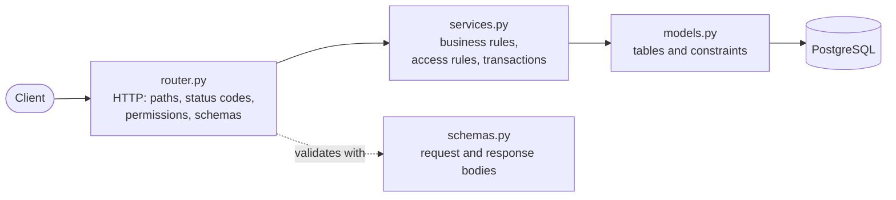
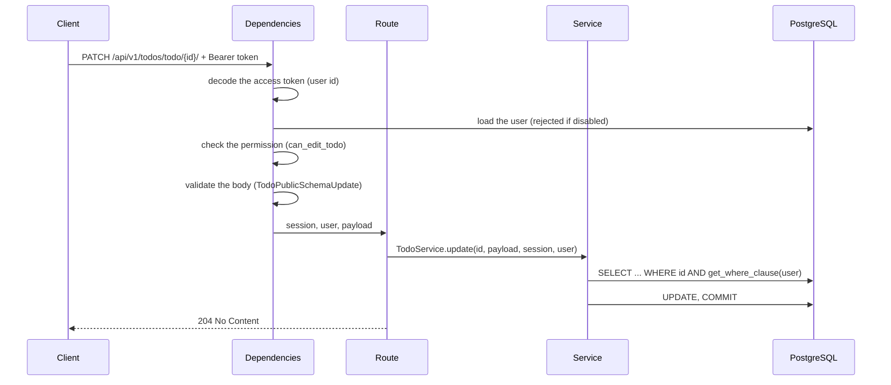
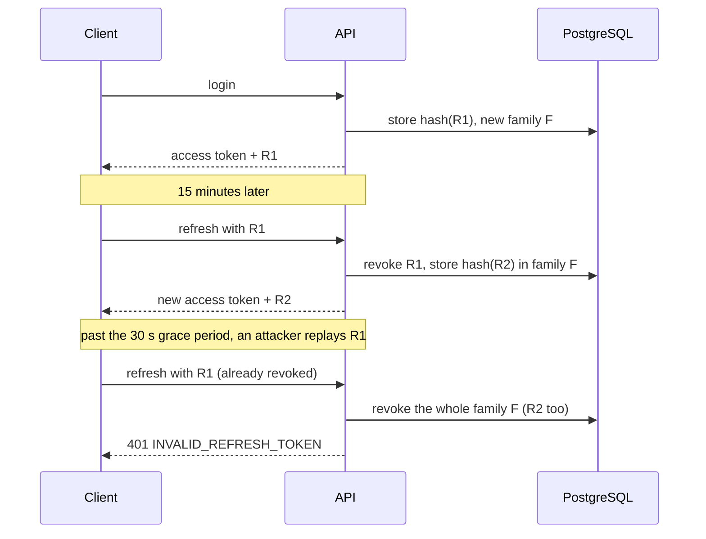
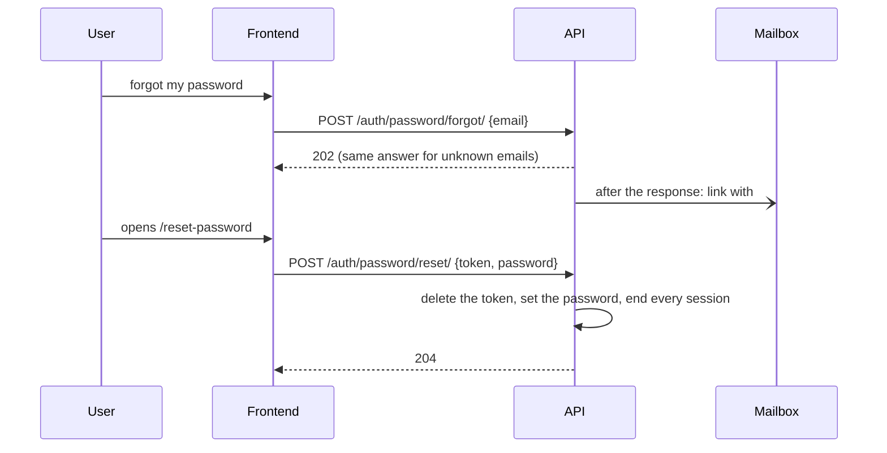
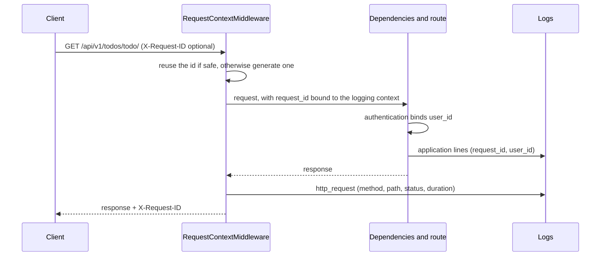
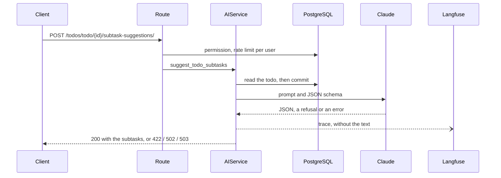
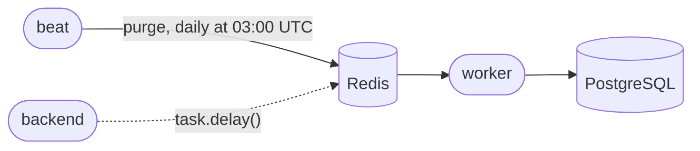

# Architecture

This document explains how the backend is organized and how a request flows
through it. The reasons behind the main choices are recorded as
[architecture decision records](adr/README.md).

## Overview

The code is split by **business domain** (`auth`, `users`, `todos`), and each
domain by **layer**:



- **Routers** are thin: they declare the HTTP contract (path, status code,
  response schema, required permission) and call one service method.
- **Services** hold the business logic: they are classes of static methods that
  receive the session, the current user and any collaborator as arguments, apply
  the access rules and own the transaction (`commit`).
- **Models** describe the tables. Each model has a `Base<Model>` class with the
  fields shared with the API schemas, so a field is declared once.

| Package | Responsibility |
|---|---|
| `app/core` | settings, database session, exceptions and their handlers, logging and the request id middleware, model registry |
| `app/commons` | base model (uuid7 id, timestamps, soft delete), column types, base schemas, pagination, CSV export |
| `app/emails` | the `EmailSender` protocol: SMTP, console (local), and sending after the response |
| `app/ratelimit` | rate limits: counters in PostgreSQL, the `RateLimiter` protocol, the client IP dependency |
| `app/filters` | `FilterBase`: declarative filters, search and ordering for list endpoints |
| `app/auth` | login, access and refresh tokens, Google sign-in, authentication and permission dependencies |
| `app/users` | users, groups and the permissions they grant, profile and administration |
| `app/todos` | the example domain: the reference to copy for new features |
| `app/cli` | Typer management CLI and the cross-domain commands (`seed`, `shell`) |
| `app/jobs` | Celery: the app, the beat schedule and the tasks <!-- copier:celery --> |
| `app/analytics` | product analytics and feature flags with PostHog: the `Analytics` protocol and its dependency <!-- copier:posthog --> |
| `app/ai` | AI features with Claude through LangChain: the chat model, prompts, schemas, Langfuse tracing <!-- copier:ai --> |
| `app/migrations` | Alembic environment and revisions |

## Request lifecycle



FastAPI resolves the dependencies before the route runs: authentication,
permission checks, body and query validation all happen there. Any error along
the way becomes a response with the same shape (see [Errors](#errors)). Around
all of this, `RequestContextMiddleware` gives the request its id and logs it
when it is over (see [Logs](#logs)).

## Authentication

Users log in with a password (`POST /api/v1/auth/login/`, the OAuth 2.0
password flow, so Swagger UI's "Authorize" button works) or with Google
(`POST /api/v1/auth/google/`, with the ID token the frontend got from Google).
Both return the same pair:

- an **access token**: a JWT valid for 15 minutes, carrying only the user id;
- a **refresh token**: a random string valid for 30 days, stored as a SHA-256
  hash in the `refreshtoken` table.



Within 30 seconds of a rotation, the old token is not treated as stolen while
its session is still open: two tabs, or two requests refreshing together, each
get a pair ([ADR 0009](adr/0009-refresh-token-reuse-grace-period.md)). Revoked
tokens are kept until they expire, since they are what detects a replay;
`just manage purge` deletes the expired ones.

Every request reads the user from the database, so disabling a user takes
effect immediately, and permissions are always computed from the current groups.
Services depend on the `PasswordHasher`, `AccessTokenCodec` and
`IdentityProvider` protocols, not on argon2, JWT or Google directly. The hasher
is async: argon2 costs ~150 ms of CPU and 64 MiB of memory by design, so it runs
in a worker thread, and a login never stalls the other requests; at most
`FASTAPI_PASSWORD_HASH_CONCURRENCY` hashes run at once per worker, so a burst of
logins waits in line instead of exhausting the memory.

Google sign-in creates a member on the first login. If a user with the same
email exists, it answers `409 ACCOUNT_EXISTS` and links nothing: the email does
not prove that the person owns that account (someone else may have registered
the address first). The user signs in with the password and links Google with
`POST /api/v1/auth/google/link/`, confirming with the password
([ADR 0010](adr/0010-external-accounts-are-linked-explicitly.md)). The links
live in the `externalidentity` table (provider + account id), so a user can have
several providers.

**Email verification and password reset** use single-use tokens, stored as
hashes and sent by email as links to the frontend
([ADR 0012](adr/0012-email-verification-and-password-reset.md)):



An address counts as verified once its owner opens such a link, or signs in
with Google when Google is authoritative for it. An unverified account never
blocks the owner of the address: the first proof of ownership hands it over and
removes every way in set up before (sessions, linked external accounts).

Registration, login, Google sign-in and linking are **rate limited**
([ADR 0011](adr/0011-rate-limits-in-postgres.md)): 5 password attempts per minute
per account and IP (login and linking share the count), 30 requests per minute
and 10 registrations per hour per IP. Over a limit the API answers `429` with
`Retry-After`. The counters live in PostgreSQL, so every worker and container
shares them; the client IP comes from `X-Forwarded-For` only when the proxy is
trusted (`FORWARDED_ALLOW_IPS`).

## Authorization

Users belong to **groups**; groups grant **permissions** (`GROUPS` in
`app/users/constants.py`); routes declare the permission they need with
`require_any_permissions`. A user without it gets `403`.

Which records a user can reach is a separate rule, written once per domain in
`get_where_clause(user)` and used by every query of the service: members reach
their own todos, `can_manage_all_todos` reaches all of them. A record outside
the user's reach answers `404`, so the API never reveals that it exists.

## Data

- **Ids** are uuid7 (time-ordered, good index locality).
- **Timestamps** use the `UTCDateTime` column type: `timestamptz`, and naive
  datetimes are rejected instead of being interpreted in the server timezone.
- **Soft delete**: `DELETE` sets `datetime_disabled`; the row is kept but hidden.
  A value that must be reusable after a delete (a slug) is unique among the
  active rows only, with a partial unique index (`WHERE datetime_disabled IS
  NULL`); a plain unique constraint would keep it taken by the deleted row.
- **Enums** are Postgres enums storing the API values (`in_progress`), sorted in
  declaration order.
- **Integrity** is enforced by the database (unique constraints, foreign keys);
  constraint names follow one naming convention, both in migrations and in tests.
- **Migrations** are generated by Alembic and applied by the container
  entrypoint, under a Postgres advisory lock so that replicas starting together
  do not migrate in parallel. `alembic check` in the test script fails if a model
  changed without a migration.
- **Branches**: the app's migrations form the `main` branch; an optional module
  with tables keeps its own branch, in its own folder of
  `app/migrations/versions/`, starting from the revision that creates `user`.
  Leaving the module out of a project drops its folder and its tables with it.
  The entrypoint and `just migrate-forward` run `alembic upgrade heads`; `just
  forge` adds to `main`, `just forge-module <module>` to a module's branch
  ([ADR 0014](adr/0014-migrations-in-branches.md)).

## Lists

List endpoints share three building blocks:

- `FilterBase` subclasses declare the filters as typed query parameters
  (`status`, `priority__in`, `due_date__lte`, `due_date__is_null`), the searchable
  columns and the sortable fields;
- `paginate()` returns a page (`items`, `total`, `page`, `size`, `pages`);
- `csv_response()` exports the same query as CSV, neutralizing the cells a
  spreadsheet would run as formulas; it streams the rows from a server-side
  cursor in batches, so an export of any size holds one batch in memory (and
  one database connection until the download ends).

## Errors

Every error has the same body, so clients can rely on a machine-readable code:

```json
{"detail": {"message": "Todo with id … not found", "errorCode": "TODO_NOT_FOUND"}}
```

| Source | Status | `errorCode` |
|---|---|---|
| Application exceptions (`app/core/exceptions.py`) | their own | specific, e.g. `TODO_NOT_FOUND` |
| Unknown route, wrong method | 404, 405 | `NOT_FOUND`, `METHOD_NOT_ALLOWED` |
| Invalid request | 422 | `VALIDATION_ERROR`, with an `errors` list that never echoes the input |
| Rate limit exceeded | 429 | `TOO_MANY_REQUESTS`, with a `Retry-After` header |
| The AI model declines, answers out of the schema, or cannot answer | 422 / 502 / 503 | `AI_REFUSAL` / `AI_INVALID_RESPONSE` / `AI_UNAVAILABLE` <!-- copier:ai --> |
| Unique / foreign key / not null violation | 409 / 422 | `CONFLICT` / `UNPROCESSABLE`, without database details |
| Anything unexpected | 500 | `SERVER_ERROR`, with the `requestId` (the traceback goes to the logs) |

## Logs

Every line goes through structlog, from the application or from a library
(uvicorn, gunicorn, Alembic, SQLAlchemy): JSON objects in remote environments,
colored key-value lines locally.



A request line in production:

```json
{"event": "http_request", "method": "GET", "path": "/api/v1/users/user/me/", "status_code": 200, "duration_ms": 8.1, "request_id": "5c33bd64…", "user_id": "01a13a8e…", "logger": "app.core.middleware", "level": "info", "timestamp": "2026-10-14T13:23:39.842336Z"}
```

- The request id comes from the `X-Request-ID` header when a proxy, a frontend
  or another service sets a safe one, so a request can be followed across
  services; otherwise it is generated.
- Unexpected errors answer `500` with the `requestId` in the body and the
  header: from a bug report to the traceback in one search.
<!-- copier:sentry:start -->
- With Sentry, unexpected errors are reported there too, tagged with the same
  request id, without personal data (`app/core/sentry.py`).
<!-- copier:sentry:end -->
- Health checks are logged at debug level, so probes do not flood the logs.
- Application code logs events with fields:
  `structlog.get_logger(__name__).info("todo_created", todo_id=str(todo.id))`;
  the request id and the user id are added automatically.

<!-- copier:posthog:start -->
## Product analytics

The services record the moments that matter to the product through
`Analytics` ([ADR 0017](adr/0017-product-analytics-with-posthog.md)), which
the route passes in like the email sender: `PostHogAnalytics` with a key,
`DisabledAnalytics` without one, `FakeAnalytics` in the tests.

- An event is captured after the commit, with the user id as PostHog's
  distinct id and only properties that hold no personal data. `capture` puts
  it in a queue that a background task of the async client sends in batches;
  the queue is flushed at shutdown.
- `require_feature_flag(flag)` asks PostHog for the flag of the current user
  on every request and answers `404` when it is off; a timeout or an error
  turns the flag off.
- The client is bound to the event loop of the worker that creates it, so the
  analytics belong to the API; a Celery task, which runs in a loop of its own,
  would need a client per run.
<!-- copier:posthog:end -->
<!-- copier:ai:start -->
## AI

The AI features call Claude through LangChain
([ADR 0016](adr/0016-ai-features-with-langchain-and-claude.md)):



- `ChatModelDep` is LangChain's `BaseChatModel`: tests replace it with a fake,
  and another provider's LangChain model could replace Claude, with its own
  error mapping in `generate`.
- The requests fit the current Claude models: no sampling parameters (they are
  rejected), adaptive thinking at an explicit effort, an answer within
  `max_tokens` without streaming, and `fallbacks: "default"`, so a request
  declined by a safety classifier runs again on another model, server-side.
- `generate` asks for the answer with `with_structured_output(method=
  "json_schema")`: the API constrains the JSON to the schema, and Pydantic
  checks what a JSON schema there cannot say (lengths, number of items).
- Langfuse gets a `TracerProvider` of its own, and the input and output
  attributes of its spans are dropped at export unless
  `LANGFUSE_CAPTURE_CONTENT` is set.
<!-- copier:ai:end -->

## Testing

- Tests run against a real PostgreSQL database created for the test session.
  Each test runs in a transaction rolled back at the end, through savepoints, so
  services commit as in production and nothing leaks between tests.
- Every test gets a fresh application from `create_app()`, the same factory as
  production; dependencies (database session, Google) are overridden per test.
- Factories generate data; named personas with fixed ids (Alice admin, Bob
  member, Carol viewer, Dave disabled) make tests readable.
- Whole responses are compared with inline snapshots; dynamic values with
  dirty-equals.
- A guard test reads the OpenAPI schema and fails if a route outside an explicit
  public list lacks authentication.
- 100% branch coverage, mypy strict, ruff, bandit and `pip-audit` gate every
  change in CI.

## Runtime

One Dockerfile, three targets sharing the same base layer:

| Target | Used by | Command |
|---|---|---|
| `remote` | production | gunicorn with uvicorn workers, non-root user |
| `test` | CI | checks, `alembic check`, tests with coverage |
| `local` | development | uvicorn with reload, source mounted |

The entrypoint applies the migrations, then starts the command. `/api/health/`
answers as long as the process runs (liveness); `/api/ready/` also checks the
database (readiness); both accept `GET` and `HEAD`. Configuration comes from
`FASTAPI_*` environment variables.
<!-- copier:sentry:start -->

Sentry is enabled when the `remote` dependency group is installed and
`SENTRY_DSN` is set.
<!-- copier:sentry:end -->

Management commands run with `just manage <command>` (Typer): `seed` fills a
local database with demo users and todos, `shell` opens IPython with the
settings, a database session and the models loaded, and each domain adds its
own (`users createsuperuser`). `purge`, to schedule daily, deletes the expired
refresh tokens and rate limit counters. A command keeps its logic in an
`execute_<command>()` function tested against the test database, and its Typer
wrapper thin. It runs with `run_with_session`, which creates an engine without
a pool for the run and disposes it before the event loop of the run closes.
<!-- copier:celery:start -->

Background jobs run on Celery
([ADR 0015](adr/0015-background-jobs-with-celery.md)): beat sends the
scheduled tasks to Redis, the backend can send its own, and the workers run
them.



A task runs its logic with `run_with_session`, like a command: connections
cannot outlive the event loop of a run, so each run gets an engine of its own.
Tasks are acknowledged once done, so they must be safe to run twice. Celery
logs through structlog (its `setup_logging` signal), and every line of a task
carries its `task_id` and `task_name`.
<!-- copier:celery:end -->
